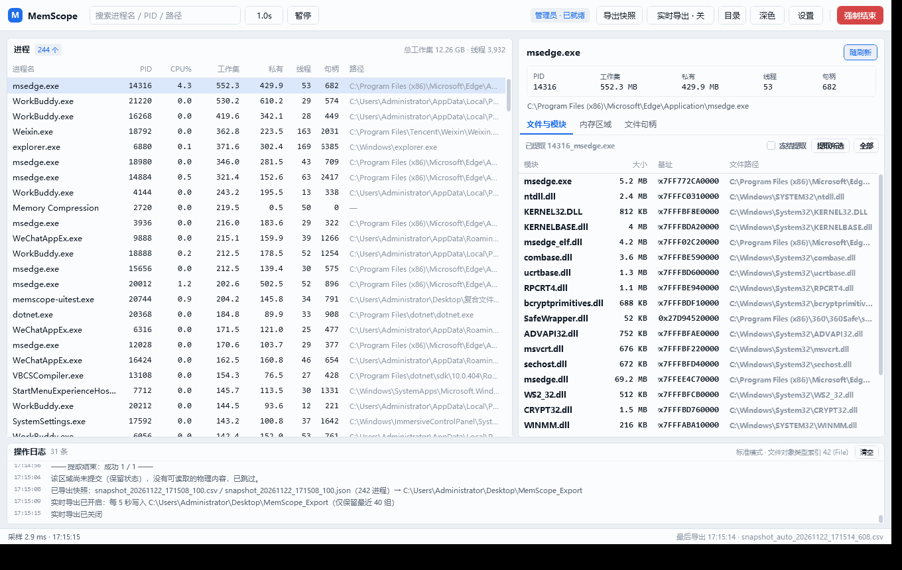
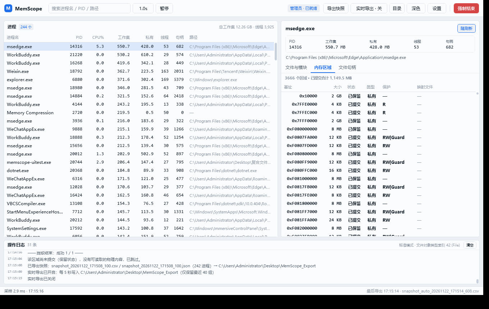
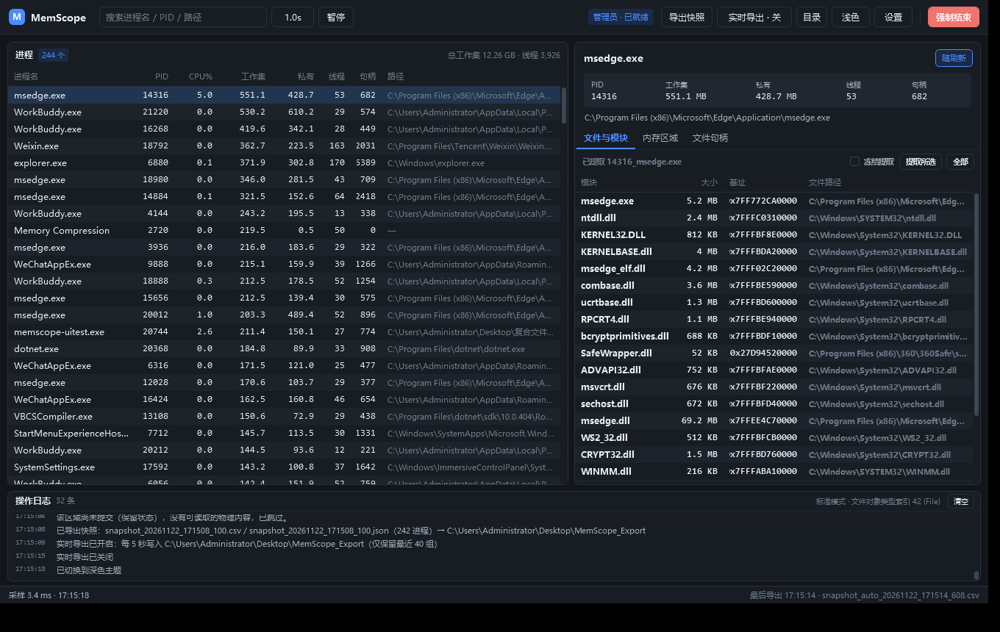

# MemScope · 内存与文件实时观测台

[](https://github.com/FuYuHang123-bot/DUMP-root/actions/workflows/build.yml)
[](LICENSE)
[](#1-用途与边界)

> Windows 进程诊断工具：实时观察进程、已加载模块、虚拟内存区域与真正打开的文件句柄；可把模块在内存中的映像还原成结构合法、能被 IDA / dumpbin / PE 工具直接打开的磁盘文件。



- 目标框架 `net10.0-windows`（x64），零第三方依赖，纯 WPF + P/Invoke
- 需要 .NET 10 桌面运行时（框架依赖发布，约 750 KB）
- 界面：浅色 / 深色双主题，双栏布局，日志常驻
- 发布构建在**编译期**剔除直连系统调用与注入路径，详见 [§4](#4-结束进程的分层路径) 与 [§10](#10-误报说明)

---

## 1. 用途与边界

**用来做什么**

- 看清一个进程到底加载了哪些文件、占了哪些内存区域、打开了哪些文件——排查「文件被谁占用」这类问题，比资源监视器给的信息细一档
- 把某个模块在内存中的运行时映像导出成合法的 PE 文件，与磁盘原件逐节比对，用于确认代码段是否被改写（例如排查注入、热补丁、运行时自修改）
- 在明确知道自己需要时，用分层调用路径结束一个常规方式结束不掉的进程

**不做什么**

- 不含任何漏洞利用代码，不扫描端口、不猜口令、不做提权利用
- 不读取凭据、不导出浏览器数据、不抓键盘输入、不驻留、不联网（源码中无任何网络 API）
- 不写注册表、不设开机自启；唯一写入的配置是 `%LOCALAPPDATA%\MemScope\settings.json`，其余输出全部落在你指定的目录
- 不绕过内核保护：被 PPL 或内核 `ObRegisterCallbacks` 保护的进程，用户态拿不到句柄，程序会如实报错而不是假装成功

**使用前提**：仅在你拥有或已获授权的系统上使用。大多数功能需要管理员权限。

## 2. 界面

双栏布局（58:42，中间可拖拽），紧凑行高（表格 23 px / 正文 11.5 pt），一屏可见 24~26 个进程。

| 区域 | 内容 |
|---|---|
| 工具栏 | 搜索（进程名 / PID / 路径）、刷新间隔（0.5/1/2/5 s）、暂停、权限徽章、导出快照、实时导出、输出目录、主题切换、设置、结束进程 |
| 左表 | 进程名、PID、CPU%、工作集、私有、线程、句柄、路径；列头排序，双击定位 exe；表头右侧常驻总工作集与线程总数 |
| 右侧 | 标题 + 五项指标条 + 完整映像路径；三个页签：**文件与模块**、**内存区域**、**文件句柄** |
| 日志（常驻） | 单行一条：`HH:mm:ss` + 摘要，失败标红、成功标绿，超长省略、悬停看全文 |
| 状态栏 | 采样耗时、最后导出时间 |

主题令牌集中在 `Assets/Theme.Light.xaml` / `Theme.Dark.xaml`，切换是热替换资源字典，控件树不重建。

| 内存区域页签 | 设置面板 |
|---|---|
|  |  |

深色主题：




采样全部在后台线程完成，UI 线程只做差量更新（PID 复用用 `CreateTime` 做 key），1 秒刷新下界面不卡。

## 3. 数据是怎么拿到的

| 数据 | 实现 |
|---|---|
| 进程列表 / 内存 / CPU 时间 | `NtQuerySystemInformation(SystemProcessInformation)` 一次拿全表；CPU% 由 Kernel+User 时间增量算出 |
| 映像路径 | `QueryFullProcessImageNameW`，按 (PID, CreateTime) 缓存 |
| 已加载模块 | `EnumProcessModulesEx(LIST_MODULES_ALL)` + `GetModuleFileNameExW` + `GetModuleInformation` |
| 虚拟内存区域 | `VirtualQueryEx` 遍历，`GetMappedFileNameW` 取映射文件，设备路径经 `QueryDosDevice` 转 DOS 路径 |
| 打开的文件 | `SystemExtendedHandleInformation` 全表快照 → 按 PID + 文件对象类型索引过滤 → `DuplicateHandle` → `NtQueryObject(ObjectNameInformation)` 取名 |

文件对象类型索引不写死：程序先打开一个文件，在句柄表里找到自己那个句柄，从中读出类型索引（本机实测 42 / `File`），再按此过滤，避免不同 Windows 版本索引漂移。

## 4. 结束进程的分层路径

默认只走标准路径。分层不是能力炫耀，是为了在日志里说清楚每一步返回了什么。

**标准模式（默认）**

| 层 | 手段 |
|---|---|
| L0 | 启用 `SeDebugPrivilege`（`RtlAdjustPrivilege`，失败回退 `AdjustTokenPrivileges`） |
| L1 | `kernel32!TerminateProcess` |

**完整功能构建（仅本地使用，`-p:EnableAdvanced=true`）**

以下三层**不参与标准发布构建的编译**，通过 `MEMSCOPE_ADVANCED` 条件编译隔离，发布件中既没有调用桩也没有注入相关导入。

| 层 | 手段 |
|---|---|
| L1′ | 从磁盘 `ntdll.dll` 解析导出表取得 SSN，构造 `mov r10,rcx / mov eax,SSN / syscall / ret` 序列，经 `NtOpenProcess` + `NtTerminateProcess` 调用 |
| L3 | `NtCreateThreadEx` 在目标进程内执行 `RtlExitUserProcess`（ntdll 由 KnownDlls 共享映射，跨进程同址） |
| L4 | `NtGetNextThread` 遍历线程 → `NtQueueApcThread` 投递退出 APC → 恢复线程 |

该构建下调用序列只落在可执行只读页：先以 `PAGE_READWRITE` 写入，随即 `VirtualProtect` 收紧为 `PAGE_EXECUTE_READ`，所有序列共用同一张 4 KB 页，进程内不存在 RWX 页。

**为什么这批能力不进发布构建**

拦截进程终止主要是内核回调 `ObRegisterCallbacks` 在做——它在 `OpenProcess` 阶段就把 `PROCESS_TERMINATE` 从句柄权限里剥掉，这与用户态走哪条调用路径无关，直连系统调用同样返回 `0xC0000022`。用户态 Hook 只影响少数场景，收益有限；而「解析系统调用号 + 自建可执行页 + 远程线程」这套动作在行为分析中与内存注入的特征高度重合，代价是实打实的。因此它在源码层面就与发布构建分离，不靠运行时开关兜底。

**做不到的部分**

被 PPL 保护的进程（`MsMpEng.exe`、`csrss.exe` 等）在打开句柄阶段即失败，用户态没有可行的办法，需要内核驱动先解除保护。程序不会假装成功：全部路径失败时输出明确结论，并逐层打印 NTSTATUS。

`csrss` / `winlogon` / `services` / `lsass` / `smss` / `System` 这类关键进程被内置清单直接拒绝（终止会导致系统蓝屏），这是硬性保护。

## 5. 从运行中的进程提取模块

选中进程 → 「文件与模块」页签选中模块 → 双击行或点「提取所选」。程序把模块的内存映像还原成结构合法的磁盘文件。

做法不是把内存整片倒出来：

1. 读 `MZ` / `PE` 头，取 `SizeOfImage`、`SizeOfHeaders`、`FileAlignment` 与节表；
2. 按节表逐节读 `SizeOfRawData`（不超过 `VirtualSize`），节区间互不重叠时并发读取（每线程独立缓冲，最多 8 路）；
3. 按原文件的 `PointerToRawData` 布局重排，产物可直接被 PE 工具、IDA、`dumpbin` 打开；
4. 用 `System.Reflection.PortableExecutable` 独立解析一遍产物做校验（节数、机器类型、`SizeOfImage` 必须对得上）；
5. 若磁盘上存在同名原文件，逐节字节比对，并把差异区分为「落在重定位表内」与「不在重定位表内」两类。

输出：`<输出目录>\modules\<PID>_<进程名>\<模块名>`，同名 `.meta.json` 记录 PID、基址、时间、SHA-256、每节读取字节数、与磁盘差异。无界面提取：`MemScope.exe --dump <PID> <模块名>`。

### 实测（本机，管理员）

```
[9] explorer.exe(6924) NSI.dll @0x7FF86D1B0000 : ok=True 40960 B / 60 ms
    pe     = True  PE 校验通过：x64 · 6 节 · SizeOfImage 0xA000
    .text     RVA 00001000  提取     8,710 B  不可读 0 B  与磁盘差异     0 B
    .rdata    RVA 00004000  提取     4,572 B  不可读 0 B  与磁盘差异   178 B
    差异构成：基址重定位项内 70 B · 导入表 IAT 108 B（8 段） · PE 头 ImageBase 字段 4 B · 可写/数据节 21 B
    可执行节（代码）内没有任何非重定位差异：代码段未被改写
    Windows 加载器映射: 成功        ← 产物交给 Windows 按 SEC_IMAGE 映射一次，合法
```

x86（WOW64）分支用 32 位 `kernel32.dll` 验证：`.text` 有 17,260 字节与磁盘不同，经重定位表逐字节核对，**全部 17,260 字节都落在重定位项覆盖范围内**——差异仅由加载器修正绝对地址（ASLR）造成。

### 三个必须说清的事实

1. **签名不在内存里**。现代 Windows 系统 DLL 在节表之后内嵌 PKCS#7 Authenticode 签名（如 `NSI.dll` 有 20,768 字节），这部分不映射进内存，所以提取结果的整文件哈希必然与磁盘文件不同。程序会明确写出这一点。
2. **提取到的是运行时状态**：IAT 已解析成真实地址、安全 Cookie 已随机化、重定位已应用。要判断代码段有没有被改写，看「不在重定位表内」的那部分差异。
3. **受保护进程读不了**：PPL 保护的进程连 `PROCESS_VM_READ` 都拿不到，在打开句柄阶段即失败，不会产出半截文件。

## 6. 性能

实测环境：i7-10700F / 16 线程 / 管理员 / 同一模块反复多次取中位。

这台机器没有 SHA-NI 指令，SHA-256 只有软件实现约 460 MB/s，343 MB 模块单是算哈希就要 0.75 s。所以优化的重点不是让哈希变快，而是**不让哈希挡在返回路径上**。

| 模块 | 大小 | 关键路径（产物可用） | 完整墙钟（含 sha256） |
|---|---|---|---|
| `AEPIC.dll` | 1.3 MB | 24~33 ms | 同左（哈希 3 ms 已含） |
| `windows.storage.dll` | 9.1 MB | 32~40 ms | 同左（哈希 19 ms） |
| `msedge.dll` | 343 MB | **430~600 ms**（中位 494） | 900~940 ms |

关键路径 = 调用返回、产物已落盘且通过 PE 校验的时刻；`sha256` 只是文件指纹，由后台线程算完后补写进日志与 `.meta.json`。343 MB 单轮构成：读内存 104 ms · 落盘 228 ms · PE 校验 1 ms · 磁盘比对 122 ms（与落盘并行）· 后台哈希 840 ms。

四处关键改动：

1. **哈希退出关键路径**：`HashTask` 后台完成 sha256 与 meta 重写；钉住的内存缓冲（`GCHandle`）在哈希结束后才解除固定（`ContinueWith`），避免 GC 搬移导致读到脏数据。
2. **大文件不再重复算磁盘原件哈希**：一致性本来由逐字节比对给出，超过 64 MB 就跳过整文件哈希并在报告里写明。
3. **比对先整块 `SequenceEqual`**：映像里绝大多数块与磁盘一致，内部走向量化 memcmp；不等时才回落到 8 字节粗筛 + 逐字节定位。比对从 ~330 ms 降到 ~120 ms。
4. **`.part` 落盘 + 原子改名**：实时防护的文件过滤驱动会逐字节扫描写出的 PE，写完还锁着文件；改为写临时名再 `MoveFileEx(REPLACE_EXISTING)`，产物对旁观者始终完整。

落盘耗时在 150~280 ms 之间波动（过滤驱动与视频解码都在抢资源），上表是干扰下的中位数，不是理想值。不同机器的绝对数字不可直接比较，但「关键路径 ≈ 读 + 落盘，哈希与比对并行」这个结构是可复现的。

## 7. 构建与自检

```bash
# 标准构建（对外发布用）：不含直连系统调用与注入路径，相关代码在编译期剔除
dotnet build MemScope/MemScope.csproj -c Release

# 完整功能构建（仅本地使用）：多定义 MEMSCOPE_ADVANCED，启用直连系统调用与远程线程/APC
dotnet build MemScope/MemScope.csproj -c Release -p:EnableAdvanced=true

# 发布（目录版，多文件）
dotnet publish MemScope/MemScope.csproj -c Release -r win-x64 --self-contained false -o dist/MemScope

# 打包 MSI（WiX 5；每用户安装，不请求管理员权限）
dotnet tool install --global wix --version 5.*
wix build installer/Package.wxs -arch x64 -o dist/installer/MemScope-1.0.1-x64.msi

# 代码签名（自签名证书，需先导入 Cert:\LocalMachine\My）
signtool sign /sm /s My /sha1 <证书指纹> /fd SHA256 /td SHA256 ^
  /tr http://timestamp.digicert.com dist\MemScope\MemScope.exe dist\MemScope\MemScope.dll dist\installer\MemScope-1.0.1-x64.msi

# 发布门禁：校验产物不含直连系统调用与远程执行特征（CI 与本机共用同一份脚本）
powershell -File scripts/verify-standard-build.ps1 -Path dist/MemScope/MemScope.dll

# 引擎自检：进程 / 内存 / 句柄 / 终止 / 导出 / 模块提取 x64+x86 / 失败路径
dotnet run --project MemScope.Cli -c Release

# 界面自检：离屏渲染各页签与主题，输出 PNG 并验证搜索、导出、主题切换
dotnet run --project MemScope.UiTest -c Release

# 内置探针
dist/MemScope/MemScope.exe --probe --out probe.json

# 无界面提取模块
dist/MemScope/MemScope.exe --dump <PID> <模块名> [--dir <输出目录>]

# 引擎基准：逐段计时 + 产物回读自校验
dist/MemScope/MemScope.exe --bench <PID> <模块名> [次数] [--dir <输出目录>]
```

> 标准构建与完整功能构建的差异只体现在**编译产物**上：标准构建的 `MemScope.dll` 中
> `NtCreateThreadEx`、`NtQueueApcThread`、`NtGetNextThread`、`VirtualAlloc`、`VirtualProtect`、
> `RtlExitUserProcess` 均为零命中，也不存在 `4C 8B D1 B8` 调用桩字节序列，PE 节区不含可写可执行段。
> 这条约束由 `scripts/verify-standard-build.ps1` 固化，CI 每次提交都会跑一遍——只靠人记着，早晚会漏。
>
> 持续集成：`.github/workflows/build.yml` 在 Windows 上并行构建标准版与完整功能版，
> 对标准版执行上述门禁并归档发布件；完整功能版只做编译验证，确保隔离改动不会悄悄弄坏它。


## 8. 目录

```
MemScope/                  主程序（WPF）
  Interop/NativeMethods.cs   P/Invoke 与结构体定义
  Interop/NtNative.cs        ntdll 常规导出直调（标准路径）
  Interop/Syscall.cs         直连系统调用层（仅 EnableAdvanced 构建编译）
  Core/ProcessSnapshot.cs    进程全表采样
  Core/MemoryMapScanner.cs   虚拟内存区域 / 模块
  Core/HandleScanner.cs      文件句柄反查
  Core/Killer.cs             分层结束进程
  Core/ModuleDumper.cs       模块 PE 提取 / 区域转储 / 磁盘比对
  Core/TargetProcess.cs      目标进程打开
  Core/SnapshotExporter.cs   CSV / JSON 导出
  AppSettings.cs             全局设置
  SettingsWindow.xaml(.cs)   独立设置面板
  MainWindow.xaml(.cs)       界面与交互
  MainWindow.Dump.cs         提取相关交互
MemScope.Cli/             控制台自检（无界面验证引擎全链路）
MemScope.UiTest/          UI 自检（离屏渲染 + 截图 + 交互链路）
installer/Package.wxs      MSI 安装包定义（WiX）
scripts/                  构建门禁：发布件特征校验
.github/workflows/        持续集成（双配置构建 + 门禁）
docs/screenshots/         界面截图
CHANGELOG.md              变更记录
```

## 9. 已知限制

- 需要管理员权限才能覆盖大部分系统进程；未提权时工具栏有徽章可一键重启提权。
- **sha256 在后台算**：提取一返回即可用，哈希算完再补一行日志 / 重写 `.meta.json`；`--dump` 与批量归档会等哈希。
- **落盘速度受实时防护影响**：过滤驱动逐字节扫描写出的 PE，可能让耗时翻倍且扫完前锁文件。程序用临时名 + 原子改名降低影响，并对独占打开做退避重试。
- 句柄扫描按 PID 逐个进行，单进程 6 秒超时保护（极少数同步管道句柄会让 `NtQueryObject` 阻塞，已按访问掩码预过滤）。
- 空路径进程（受保护 / 已退出）在列表中显示 `—`。
- 内存区域上限 8000 条，超出截断（正常进程 600~4500 条）。
- 模块提取单文件上限 512 MB；峰值内存约为模块大小 + 150 MB。
- 提取默认不冻结目标进程；对持续改写自身代码的进程，结果可能略有漂移，勾选「冻结提取」（`NtSuspendProcess` / `NtResumeProcess`）可消除。
- 节内被保护或未提交的页会被清零并在日志中报出字节数。

## 10. 误报说明

进程观察与内存提取类工具被安全软件标记，是这个品类的常态——读其他进程内存、开高权限句柄、结束进程，这些动作同时也出现在恶意软件的早期阶段。

发布构建已把最容易触发静态特征的部分**从编译产物中移除**：直连系统调用层（系统调用号解析、调用桩、`VirtualAlloc`/`VirtualProtect`）、远程线程与 APC 投递（`NtCreateThreadEx`/`NtQueueApcThread`）均不参与编译，`MemScope.dll` 中这几个符号零命中，也不存在 `4C 8B D1 B8` 桩字节。

当前发布件使用**自签名证书**（`CN=MemScope`，RSA 4096 / SHA-256 / RFC3161 时间戳）签名，`MemScope.exe`、`MemScope.dll`、MSI 安装包三者均已签名。需要注意的是：仅对已把该根证书装入「受信任的根证书颁发机构」的机器有效，未安装的机器上证书链验证会失败，SmartScreen 仍会拦截。

如果遇到误报，请把以下信息一起提交给厂商，有助于快速定位：文件 SHA-256、触发拦截的具体动作、Windows 版本与安全软件版本。恶意软件不会把完整源码、构建脚本和逐节比对报告一起公开，这是本项目最有说服力的证明。

## 11. 许可

MIT License，见 [LICENSE](LICENSE)。版本变更见 [CHANGELOG.md](CHANGELOG.md)。

使用本工具处理他人系统上的进程时，请确认你已获得授权。
